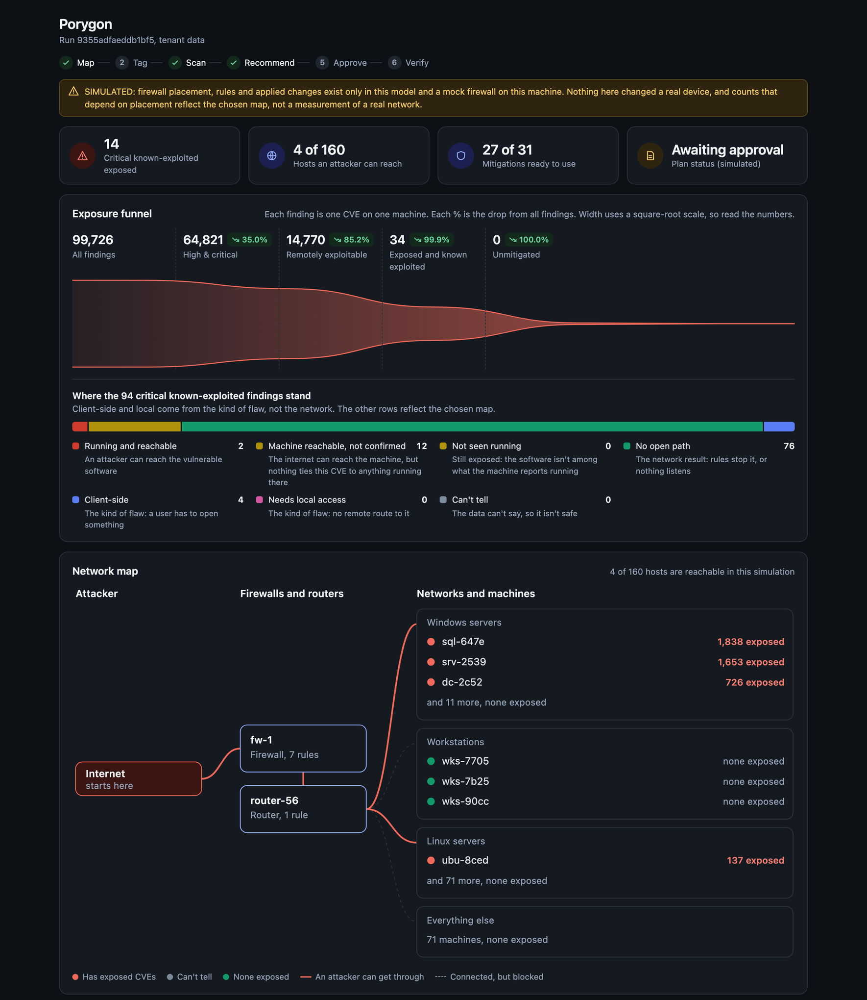
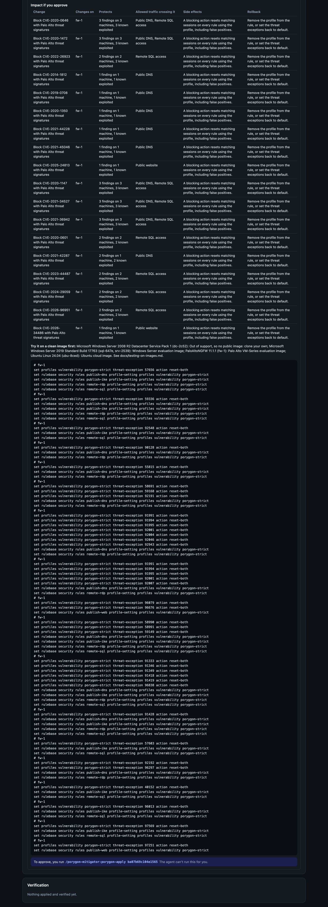
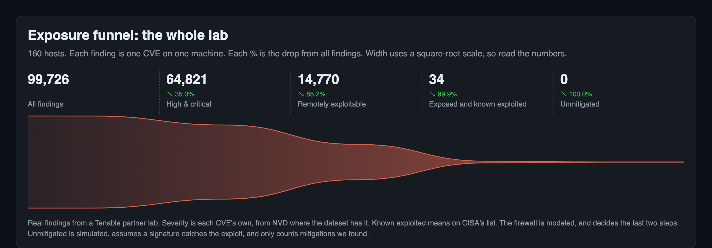
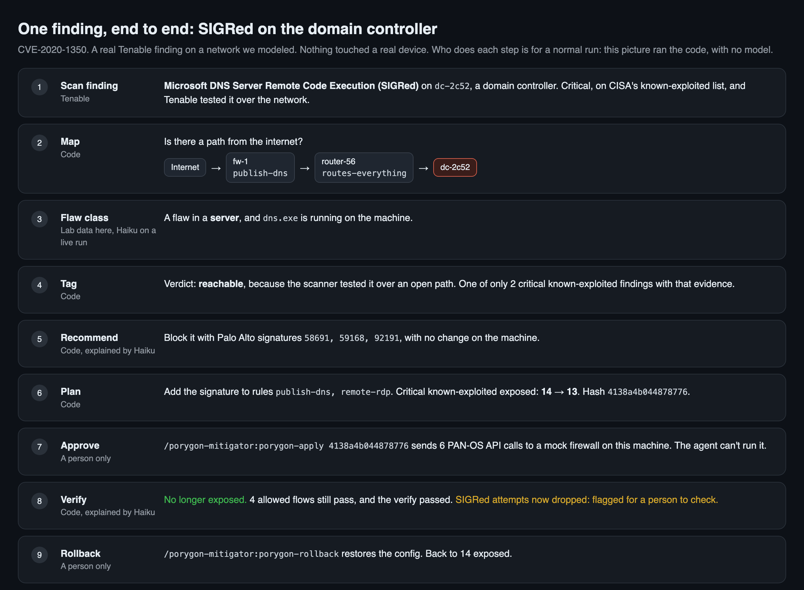
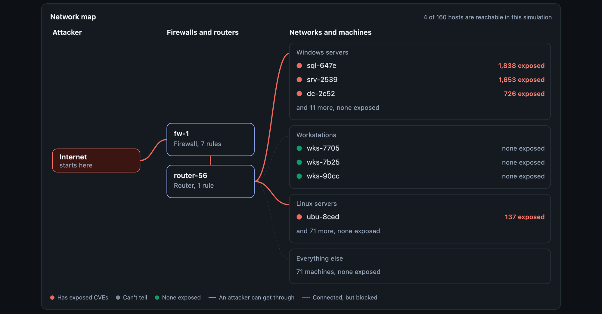
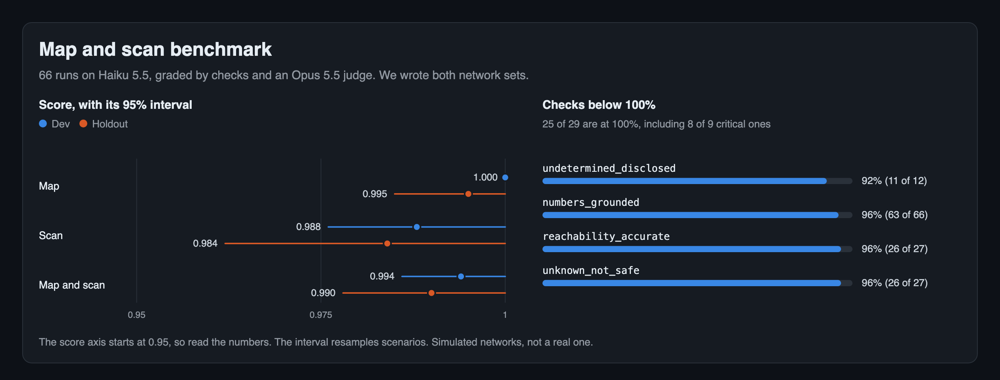

# porygon-mitigator

**From thousands of findings to one approved, verified mitigation plan.**

Porygon is an open-source agent for Claude Code, built on Tenable data. It works out which vulnerabilities an attacker can
actually reach through your firewalls, finds the mitigations that stop them without breaking allowed traffic, and prepares
PAN-OS changes, with rollback, for a person to approve.



*Real findings from a Tenable partner lab, on a network we modeled.*

## How it works

1. **Map**
   - Collect firewall rules and routes, router tables and asset data: prepared files in the demo, or a real
     Palo Alto export from `porygon panos collect`
   - Find the single firewall rule deciding each path
2. **Tag**
   - Extract each CVE's class, processes, protocols and versions from scanner text, with a Haiku subagent, or for many CVEs at
     once with `porygon tag`
3. **Scan**
   - Check what each attacker zone can reach
   - Compare each CVE with what's actually running on each machine, and give it a verdict: reachable, not seen running, not
     reachable, local only or unknown
4. **Recommend**
   - Simulate what each mitigation protects and breaks. Open Snort and Suricata rules for a CVE come from `porygon rules find`,
     and `porygon panos coverage` says which signatures a real firewall has installed and enforces
   - Pick the best set, and say why
   - Plan the exact change and show its impact
5. **Approve**
   - Only a person can run the command, and the agent has no way to
6. **Verify**
   - Check the result against the plan, or roll it back



The details are in [docs/flow.md](docs/flow.md).

## Prerequisites

- Python 3.11+ and [uv](https://docs.astral.sh/uv/)
- [Claude Code](https://claude.com/claude-code), to use the agent

The demo below needs no API keys.

## Quick start

```bash
git clone https://github.com/ori-astsec/tenable-porygon-mitigator.git porygon-mitigator && cd porygon-mitigator
uv sync
```

**With the agent:**

```bash
claude --plugin-dir . --agent porygon-mitigator:porygon
```

Then ask: *"Run the whole flow on the bundled network and take me up to approval."*

**Without it,** on the command line:

```bash
uv run porygon flow collect
uv run porygon flow map --restart
uv run porygon flow recommend
uv run porygon flow plan sigred-ips bluekeep-ips
uv run porygon flow report --out flow.html
```

Open `flow.html` to see the dashboard. `flow plan` prints a hash, which you can approve and check:

```bash
uv run porygon flow apply <hash>
uv run porygon flow verify
uv run porygon flow rollback
```

The lab's own run needs a Tenable export of the lab, which isn't in this repo, so without one the demo above is what runs.
With one, build its environment ([how](demo/tenable-lab/README.md#the-flow-on-this-network)), then pass
`--sources "$PWD/demo/tenable-lab/flow/sources"` to `flow collect` and `flow map`.

## Output

- **A dashboard,** as an MCP App or [one HTML file](examples/flow/sample-report.html): the funnel, network map, attack paths,
  mitigations, plan and verification.
- **A plan you can act on:** each change, its impact, its rollback, and where to
  [try it on a clean image](docs/testing-on-images.md) first.
- **JSON for every step,** under `~/.porygon/flow/`.

## Results on the lab data

We ran it on all 160 hosts with findings in a Tenable partner lab: 99,726 findings, each one CVE on one machine. The findings are real, and the
network around them is modeled. [The impact report](docs/impact.md) has every number and what each depends on.



| Step | Count | Comes from |
|---|---:|---|
| All findings | 99,726 | Tenable's scan |
| High & critical | 64,821 | Each CVE's own severity, from NVD where the dataset has it ([details](docs/impact.md)) |
| Remotely exploitable | 14,770 | Tenable's vector and each CVE's flaw class, from data that isn't in this repo ([details](docs/impact.md)) |
| Exposed and known exploited | 34 | On CISA's list, with an open path through invented firewall rules |
| Unmitigated | 0 | Simulated: what the recommended mitigations would leave open |

Recommend focuses on known-exploited findings, and leaves out mitigations that stop none of them. The plan stops all 34 with Palo Alto signatures, and that
rests on an assumption: a signature counts when it's on every rule letting traffic through, even where Tenable only read the patch level, and whether it catches the exploit isn't tested.

This is the case with the strongest evidence: critical, known exploited, tested over the network, and on a domain controller. It's one mitigation stopping
one finding, followed from scan to rollback with values read from a run of the code:



And the network it runs on, the whole lab. Only the 4 hosts the modeled firewall publishes are exposed:



And how the map and scan steps score on the benchmark:



This shows what the method does on real findings. It isn't a measurement of a real network.

## What's real

- **Real:** Tenable hosts, running processes and services, and findings from the lab, which Tenable provided. All host names, IPs and asset ids, for the 8 hosts bundled for the demo and in the whole-lab report and pictures, are random replacements for the lab's own. CISA KEV. Documented mitigations.
- **Simulated:** the firewall and router exports (prepared files), the firewall rules (invented), and every applied change.
- **Built, not run on the lab:** the read-only Palo Alto collector. The lab's firewalls are scan targets we don't own, so its tests
  use XML API answers shaped like a real device's.
- **From a model:** the CVE details from the Tag step, which can add exposure but never clear a CVE, and the agent's explanations. Its counts come from the tools, though it may add them up.

## Limitations

- It has run on a live Tenable partner lab tenant, which has no firewalls in front of its hosts, so the network was modeled.
  Applying a plan goes to a local test firewall, and the Palo Alto collector is tested against XML API answers shaped like a
  real device's.
- Scanner text is often thin, so many details stay empty, and a wrong one can raise a false alarm.
- The recommendation picks the biggest gain step by step, which isn't always the smallest set.
- The Tenable tag and rescan (`--tenable-execute`) and the MCP App haven't been run against a live tenant or a real MCP host.
- A different model you give its own shell could run the CLI: the approval gate binds this agent and its commands.

All of them are in [docs/research.md](docs/research.md#all-limitations).

## Configuration

The demo needs none of these.

| Variable | For |
|---|---|
| `ANTHROPIC_API_KEY` | Live mitigation research |
| `PALO_ALTO_THREAT_VAULT_API_KEY` | Finding Palo Alto signatures |
| `PANOS_API_KEY` | Reading your own Palo Alto firewall or Panorama (`porygon panos collect`) |
| `TENABLE_ACCESS_KEY`, `TENABLE_SECRET_KEY` | Reading your Tenable tenant |
| `PORYGON_FLOW_DIR` | Where run files go |

The full list is in [docs/research.md](docs/research.md#configuration).

## Sources and outbound connections

The demo makes no outbound calls. With live research or Tenable, porygon only contacts the hosts below, and its HTTP client
refuses any other, including on redirects. The one addition is `porygon panos collect`, which contacts only the firewall or
Panorama you pass as `--host`, with a client that sends nothing but read calls. `porygon flow apply`, `verify` and
`rollback`, and `flow_watch_traffic`, also call a mock firewall they start on 127.0.0.1, and refuse any other address. No telemetry.

<details>
<summary>All hosts</summary>

<!-- egress:start -->
| Host | Used for | Category |
|---|---|---|
| `api.anthropic.com` | Claude API: extraction, arbitration, web search | llm |
| `cveawg.mitre.org` | CVE records (CVE JSON 5) | cve_data |
| `services.nvd.nist.gov` | NVD CVE API 2.0: CPE ranges, tagged references | cve_data |
| `nvd.nist.gov` | NVD vulnerability pages | cve_data |
| `www.cisa.gov` | CISA KEV catalog, advisories and alerts | government |
| `kb.cert.org` | CERT/CC vulnerability notes (often list workarounds) | government |
| `api.osv.dev` | OSV vulnerability API (GHSA and ecosystem advisories) | cve_data |
| `access.redhat.com` | Red Hat Security Data API and CVE pages | distro |
| `ubuntu.com` | Ubuntu CVE tracker | distro |
| `security-tracker.debian.org` | Debian security tracker | distro |
| `www.suse.com` | SUSE CVE pages | distro |
| `alas.aws.amazon.com` | Amazon Linux security advisories | distro |
| `api.msrc.microsoft.com` | Microsoft CVRF API (workarounds, mitigations) | vendor |
| `msrc.microsoft.com` | Microsoft Security Response Center | vendor |
| `www.microsoft.com` | MSRC blog guidance | vendor |
| `learn.microsoft.com` | Microsoft docs (ASR rules, Azure WAF rules) | vendor |
| `support.microsoft.com` | Microsoft KB articles | vendor |
| `techcommunity.microsoft.com` | Microsoft product team guidance | vendor |
| `security.paloaltonetworks.com` | Palo Alto Networks security advisories | vendor |
| `unit42.paloaltonetworks.com` | Unit 42 threat briefs | research |
| `docs.paloaltonetworks.com` | Palo Alto Networks documentation | vendor |
| `sec.cloudapps.cisco.com` | Cisco security advisories | vendor |
| `blog.talosintelligence.com` | Cisco Talos coverage notes | research |
| `www.fortiguard.com` | Fortinet PSIRT advisories | vendor |
| `support.citrix.com` | Citrix / NetScaler security bulletins | vendor |
| `www.netscaler.com` | NetScaler blog guidance | vendor |
| `my.f5.com` | F5 security advisories | vendor |
| `support.broadcom.com` | VMware (Broadcom) security advisories | vendor |
| `supportportal.juniper.net` | Juniper security advisories | vendor |
| `forums.ivanti.com` | Ivanti security advisories | vendor |
| `advisories.checkpoint.com` | Check Point advisories | vendor |
| `confluence.atlassian.com` | Atlassian security advisories | vendor |
| `www.oracle.com` | Oracle security alerts | vendor |
| `www.ibm.com` | IBM security bulletins | vendor |
| `logging.apache.org` | Apache Logging (Log4j) security page | project |
| `httpd.apache.org` | Apache HTTP Server vulnerabilities | project |
| `tomcat.apache.org` | Apache Tomcat security pages | project |
| `cwiki.apache.org` | Apache project security bulletins (Struts...) | project |
| `www.openssh.com` | OpenSSH release and security notes | project |
| `openssl-library.org` | OpenSSL security advisories | project |
| `nginx.org` | nginx security advisories | project |
| `www.php.net` | PHP changelog | project |
| `nodejs.org` | Node.js security releases | project |
| `www.jenkins.io` | Jenkins security advisories | project |
| `spring.io` | Spring security advisories | project |
| `about.gitlab.com` | GitLab security releases | project |
| `www.openwall.com` | oss-security mailing list archive | project |
| `curl.se` | curl security advisories | project |
| `www.papercut.com` | PaperCut security bulletins | vendor |
| `github.com` | GitHub security advisories | project |
| `developers.cloudflare.com` | Cloudflare WAF changelog and docs | waf_ips |
| `blog.cloudflare.com` | Cloudflare WAF rule announcements | waf_ips |
| `docs.aws.amazon.com` | AWS WAF managed rule documentation | waf_ips |
| `cloud.google.com` | Cloud Armor preconfigured WAF rules | waf_ips |
| `www.snort.org` | Snort 3 community rules and rule docs | waf_ips |
| `snort-org-site.s3.amazonaws.com` | Snort rule downloads (snort.org redirects here) | waf_ips |
| `rules.emergingthreats.net` | Proofpoint ET Open rules | waf_ips |
| `docs.cloud.f5.com` | F5 attack signature reference | waf_ips |
| `docs.netscaler.com` | NetScaler WAF signature updates | waf_ips |
| `api.threatvault.paloaltonetworks.com` | Palo Alto Threat Vault API (only with your own key) | waf_ips |
| `www.tenable.com` | Tenable CVE pages and research blog | research |
| `blog.qualys.com` | Qualys threat research | research |
| `www.rapid7.com` | Rapid7 analysis | research |
| `www.huntress.com` | Huntress analysis | research |
| `cloud.tenable.com` | Tenable One / Tenable VM API (your tenant) | tenable |
<!-- egress:end -->

What leaves your machine: CVE IDs and advisory text go to the Anthropic API for extraction, and `porygon tag` also sends
the scanner text of the findings it tags. Machine profiles are never
sent to any service by porygon: matching is local. Over MCP, results (including machine names) go to your client and
its model. Tenable keys are only used against your own tenant. The optional `--tenable-execute` follow-up also sends that
tenant the affected asset ids and IP addresses.

</details>

## MCP tools

<details>
<summary>All tools</summary>

<!-- tools:start -->
| Tool | Read-only | Network | What it does |
|---|---|---|---|
| `find_mitigations` | no (writes local files) | yes | Find documented compensating controls for a CVE and rank the ones that apply to the given machine. |
| `assess_machine` | yes | no | Rank a CVE's cached mitigations for one machine without any network access: is the machine affected, which mitigations apply, which are already in place, which need a device or tool it lacks. |
| `get_cve_mitigations` | yes | no | Return the cached mitigation record for a CVE (no network): every mitigation with steps and evidence. |
| `list_cached_cves` | yes | no | List the CVEs in the local cache with their number of active mitigations and freshness. |
| `source_status` | yes | no | Show which sources were checked for a cached CVE and what each yielded (ok, no_mitigation, ...). |
| `exposure_funnel` | no (writes local files) | yes | Exposure funnel over Tenable findings: all open findings -> high/critical (plugin CVSS >= 7.0) -> remote (attack vector network) -> stoppable by an IPS signature, with the signature count per vendor (Cisco Talos Snort 3, Proofpoint ET Open, Palo Alto Threat Vault when synced, Check Point). |
| `scan_coverage` | yes | yes | Report what the Tenable VM scanner could not see on each machine and what to fix first: failed or missing logins, findings the latest scan didn't re-check, ports never probed from the network, web tests disabled. |
| `flow_collect` | no (writes local files) | no | Collect one source before mapping the network: `firewall` (routes, rules, objects), `router` (routing tables) or `assets` (asset network data and network events). |
| `flow_map_routes` | no (writes local files) | no | After every source is collected: join them into one network, starting a run on it. |
| `flow_vulnerabilities_to_normalize` | yes | no | The next batch of vulnerabilities whose details aren't normalized yet, most urgent first, with the scanner text they come from. |
| `flow_save_normalized` | no (writes local files) | no | Save normalized details: flaw class, process names, loaded libraries, protocols, affected versions, exploitation requirements and constraints. |
| `flow_recommend_plan` | yes | no | Work out what to mitigate and how before asking the person: as few mitigations as it can find that stop the most exposure without breaking allowed traffic, why each was picked, and what stays exposed. |
| `flow_find_mitigations` | no (writes local files) | yes | Find mitigations for CVEs from outside the run and add them to it. |
| `flow_load_environment` | no (writes local files) | no | Start a simulated flow run from an environment file and a mitigations file (absolute paths), or from the bundled synthetic network with bundled_example=true. |
| `flow_reachability` | no (writes local files) | no | Run the simulated scan: which hosts each attacker zone can reach, and through which rules. |
| `flow_tag_cves` | no (writes local files) | no | Compare every CVE on every host with whether the internet reaches it and what's running there, tag it reachable, host_reachable, not_seen_running, not_reachable, local_only or unknown, and return the funnel from all findings down to what's still exposed. |
| `flow_match_mitigations` | no (writes local files) | no | Rank the mitigations for this environment by simulating each: what it protects and which allowed traffic it breaks. |
| `flow_read_source` | no (writes local files) | no | Read a source file in a format `flow_collect` doesn't know, so you can convert it for `flow_save_source`. |
| `flow_save_source` | no (writes local files) | no | Save a source you converted, in the shape `flow_collect` reads, then collect and map from the `sources_dir` it returns. |
| `flow_propose_zone` | no (writes local files) | no | Propose a zone for a host the map couldn't place, saying what in the sources points to it. |
| `flow_check_path` | yes | no | Check whether a zone the scan doesn't cover, such as one that isn't an attacker's, reaches a host. |
| `flow_try_mitigations` | yes | no | Test a set of mitigations you think beats the recommendation. |
| `flow_watch_traffic` | yes | no | Connect to the firewall and read its traffic log, then replay those sessions against each mitigation before anything is planned: what it would drop that has to keep working, unknown traffic it would drop, and attacks it would stop. |
| `flow_plan_change` | no (writes local files) | no | Build the exact change for the selected mitigations and return its diff and hash. |
| `flow_verify` | no (writes local files) | no | After a person applied a plan, recompute reachability from the changed environment and compare it with what the plan promised: what stopped being exposed, any new exposure, whether allowed traffic still passes, and whether anything else in the network changed. |
| `flow_dashboard` | yes | no | Show the flow as a dashboard: the scan, the network map, the funnel, the mitigations, the plan and its verification. |
<!-- tools:end -->

</details>

## Learn more

- [The flow, step by step](docs/flow.md)
- [Researching one CVE](docs/research.md): the mitigation finder underneath, usable on its own
- [Trying a change on a clean image](docs/testing-on-images.md)
- [Security](SECURITY.md) and [contributing](CONTRIBUTING.md)

## License

MIT, see [LICENSE](LICENSE). Third-party data terms are in [THIRD_PARTY_NOTICES.md](THIRD_PARTY_NOTICES.md).
