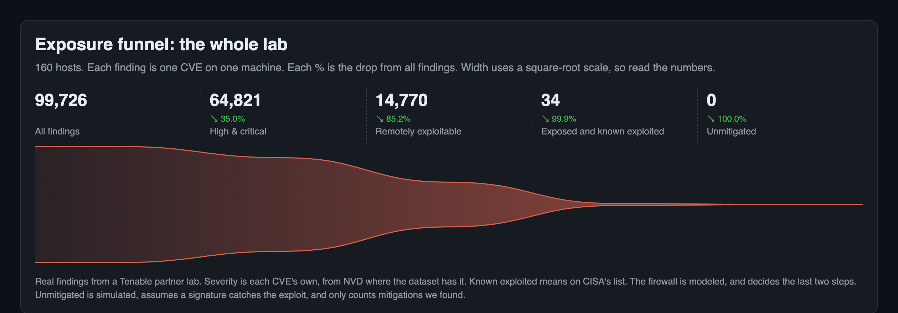

# Impact on the whole lab

What the flow does to every host with findings in a Tenable partner lab: 160 hosts and 99,726 findings, each one CVE on one machine. The
numbers are in [`impact.json`](../evals/flow/results/final-2026-11-04/impact.json), with no tenant names or addresses. They were built from a private export of the tenant and per-CVE labels that aren't in this repo, so
they can't be regenerated from it.

**The findings are real and the network isn't.** Tenable holds no firewalls or routes, so Exposed and everything after it depends on a network
we chose. Nothing touched a real device, and nothing was written to the tenant.

## What doesn't depend on the network

| Step | Count | Comes from |
|---|---:|---|
| All findings | 99,726 | Tenable's scan, on 27,702 distinct CVEs |
| High & critical | 64,821 | Each CVE's own severity, since a Tenable patch plugin shares one across every CVE it fixes |
| Remotely exploitable | 14,770 | Tenable's vector and each CVE's flaw class, from an external vulnerability dataset |

**Where severity comes from.** That dataset gives NVD's severity for 10,936 of the 27,702 CVEs and NVD's score for 4,073 more. For 11,958 it has only the highest CVSS it holds, from any source. That leaves 735 CVEs, about 2,000 findings, on Tenable's plugin severity. Using Tenable's severity instead, High & critical is 77,777, a physical-access CVE such as CVE-2025-24984 reads as critical, and CVE-2020-1472 (Zerologon) doesn't read as critical.

Of the 94 that are remote, critical and known exploited, 4 are client-side, which leaves 90 before any network is considered.

## What depends on the network

Four assumptions about what the internet can reach, on the same findings. The funnel's last two steps are the middle two number columns, and the last column counts all high and critical findings, for scale:

| Network | Hosts exposed | Exposed and known exploited | Unmitigated | All high and critical: exposed, reachable |
|---|---:|---:|---:|---:|
| The modeled firewall, publishing 4 hosts | 4 | 34 | 0 | 3,071, 6 |
| The same, with Haiku's tags | 4 | 34 | 0 | 3,071, 443 |
| Only the 4 hosts with public addresses | 3 | 3 | 3 | 435, 8 |
| A firewall that allows everything | 121 | 181 | 94 | 14,770, 199 |

- **The modeled firewall** is the one in [the lab data](../demo/tenable-lab/README.md), chosen so the 8 demo hosts have documented mitigations. Every other host
  sits behind it with nothing published, so most of the drop to Exposed is that choice.
- **Haiku's tags** name the software for 7,637 CVEs on the 8 demo hosts, so a finding becomes Reachable when that software is running. They don't change the known-exploited steps here. These aren't in the lab
  data, and they haven't been audited on this engine.
- **Public addresses** are the one real network fact we have: 4 hosts have one, though that doesn't prove anything answers on it. None of them is a demo host, and
  no mitigation in the data covers their CVEs, which is why 3 stays 3.
- **A firewall that allows everything** is the upper bound. It still runs signatures, so its 94 assumes them. This row uses scanner evidence only, so Reachable counts what Tenable tested over the network, and Haiku's tags would raise it.

## What this doesn't prove

- **It isn't a measurement of a real network.** The 3,071 is what one invented firewall allows.
- **Severity isn't all NVD's.** See where it comes from above. Tenable's own product shows the plugin's severity, so these counts won't match its screens.
- **Unmitigated only counts what we looked for.** Mitigations come from the 8 demo hosts' known-exploited CVEs, plus two Tomcat fixes from this project's own search, which the plan doesn't pick. Unmitigated reaches 0 because every finding on this step has a Palo Alto signature.
- **Signatures are assumed to work.** A signature counts when it's on every rule letting traffic through, even where Tenable only read the patch level, as it did for most of the 34. Nothing tests that it catches the exploit, sees inside encrypted traffic, or that an attacker comes through the firewall.
- **The flaw classes aren't ours.** They come from an external vulnerability dataset, so someone else's scan won't narrow the same way without an equivalent. 16 of the 27,702 CVEs have no
  row at all, and 2,104 have no class, so those stay in.
- **Mitigations only exist for the demo hosts' CVEs**, so Unmitigated is only meaningful on the modeled firewall.
