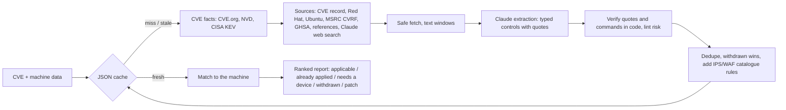

# Researching one CVE, and the full reference

The [flow](flow.md) is built on a mitigation finder you can also use on its own: verified, machine-specific
compensating controls for a CVE you can't patch yet.

Give porygon a CVE ID and a machine (a short JSON profile, or a Tenable asset export). It finds the workarounds,
configuration changes, feature and service disables, registry keys, IPS/WAF signatures and EDR rules that vendors
document. It checks every claim against the source text, and tells you which ones apply to *that* machine. It also
says which are already in place, which need a device the machine doesn't have, and which workarounds the vendor has
withdrawn. It ships as an **MCP server** (`porygon-mcp`), a **CLI** (`porygon`) and a **Claude Code plugin**.

porygon reports steps; it never runs them.

```text
$ porygon mitigate CVE-2022-30190 --machine examples/machines/win10-office-workstation.json --offline

# CVE-2022-30190 on WS-FIN-042
**Verdict: MITIGATIONS AVAILABLE** -- 3 documented mitigations apply to this machine
**Affected: AFFECTED** -- Microsoft Windows 10 Enterprise 21H2 (OS) is in the vulnerable range (< 10.0.19044.1766)

## Apply now (ranked)
### 1. Delete the ms-msdt URL protocol registry key
`REGISTRY_KEY` | layer: host | max step risk: 2 (changes the system) | vendor documented
Why: windows host; registry key hkcr\ms-msdt is present
3. Delete the key. [risk 2: changes the system]
   `reg delete HKEY_CLASSES_ROOT\ms-msdt /f`
- Rollback (from the source): Run Command Prompt as Administrator and restore the backup with reg import <filename>.
> "Execute the command "reg delete HKEY_CLASSES_ROOT\ms-msdt /f"."
> -- https://www.microsoft.com/en-us/msrc/blog/2022/05/guidance-for-cve-2022-30190-... (verified)
...
## Withdrawn workarounds: do not rely on these
- MSDT 'interactive communication' GPO (not a workaround): Microsoft states this GPO does not provide protection
```

### Why not just ask an LLM?

A model asked "how do I mitigate CVE-X" answers from memory. It can't tell you which advice applies to your
server, and it can't show you where a command came from. porygon is built so you can check every line:

- **Read, then cite, then verify in code.** Claude reads the actual advisory. Every mitigation must carry a quote
  that porygon finds verbatim in the text it fetched, or the mitigation is dropped. A command is shown only if it
  appears verbatim in the source; otherwise you're told the source doesn't give one.
- **Per-machine applicability.** Platform, installed products and versions, distro package states, listening
  services, the firewall/IPS/WAF in front of the machine, and its EDR decide what applies. Configuration state
  (sysctl, registry, services, kernel modules, app settings) shows what's already done.
- **Signatures for the device you actually have.** Public rule catalogues (Snort 3/Talos, ET Open, F5 attack
  signatures, Azure WAF, Cloudflare, optional NetScaler and Palo Alto Threat Vault) map CVEs to rule IDs. porygon
  turns each into steps for that product. `porygon rules find` returns the open Snort 3 and Suricata rules
  themselves, with whether each ships enabled and its license, and `porygon panos coverage` checks a real Palo Alto
  firewall: is the signature installed, does a vulnerability profile block it, does an allow rule use that profile,
  and has it fired.
- **Typed, reviewable records.** Each record has a type, layer, normalised action, steps with risk 0-3, side
  effects, rollback, how to verify, evidence, and confidence. Commands that download-and-run code or disable
  security tools are always flagged as risk 3.
- **Honest negatives.** "No documented mitigation: patch or isolate" is a valid answer. Withdrawn workarounds are
  shown as warnings, never recommended.
- **A shared, committed JSON cache.** Answers for known CVEs are instant and offline. A cache miss researches
  live and adds the new mitigation instances to the cache.

### How it works



If the machine is affected and nothing applies, a second, machine-aware search (its distro, the devices in front
of it, its EDR) runs before porygon says "no documented mitigation".

## Quick start

After `uv sync`, offline, no key needed (served from the committed cache):

```bash
uv run porygon mitigate CVE-2022-30190 --machine examples/machines/win10-office-workstation.json --offline
uv run porygon cache list
```

Live research for any CVE (writes the new record to the cache):

```bash
export ANTHROPIC_API_KEY=...   # your key; never committed
uv run porygon mitigate CVE-2024-6387 --machine examples/machines/ubuntu-ssh-bastion.json
```

Tenable data (experimental): map an asset export, add the devices in front of it, and assess:

```bash
uv run porygon mitigate CVE-2024-6387 --tenable-asset examples/tenable/asset.json \
  --tenable-findings examples/tenable/findings.json --overlay my-network-path.json
```

As an MCP server in Claude Code:

```bash
claude mcp add porygon -- uv run --directory "$(pwd)" porygon-mcp
```

As a Claude Code plugin (skill + MCP server):

```text
/plugin marketplace add <owner>/<repo>
/plugin install porygon-mitigator@porygon
```

## Inputs

A **machine profile** (`uv run porygon profile schema` prints the JSON Schema; `examples/machines/` has six
synthetic machines). Only `name` and `os.platform` are required; each extra field sharpens the answer:

| Field | Used for |
|---|---|
| `os` (platform, name, version, distribution) | platform filter, appliance identity, distro package states |
| `installed_software` (CPE or vendor/product/version, package) | is the vulnerable product present, which version |
| `open_ports`, `internet_exposed` | listening services and exposure |
| `network_path` (role, vendor, product) | which WAF/IPS/firewall signatures can protect it |
| `security_tools` (EDR/AV) | endpoint-protection mitigations |
| `findings` (scanner CVE findings) | "affected" straight from your scanner |
| `config_state` (sysctl, registry, services, modules, app settings) | "already applied" checks |

**Tenable**: `--tenable-asset` maps a Tenable asset export record (OS, installed-software CPEs, open ports, exposure,
connectors) plus its vulnerability rows (findings and enrichment plugin output). `porygon tenable profile --asset
<uuid>` exports one live with your `TENABLE_ACCESS_KEY`/`TENABLE_SECRET_KEY`. See
[docs/tenable-one.md](tenable-one.md).

**Scan coverage**: a machine with few findings may be one where local checks never ran. `porygon tenable coverage`
reports, per machine, what the Tenable VM scanner could not see and what to fix first, from the scan's own metadata:
failed or missing logins, findings the latest scan didn't re-check, ports never probed from the network, web tests
disabled. It reads export files (`--assets-file`, `--findings-file`) or your tenant, and doesn't include findings from
Tenable Cloud Security or OT Security.

## Output

- **Verdict:** `mitigations_available`, `already_mitigated`, `needs_additional_controls`,
  `no_documented_mitigation`, `not_affected`, `unknown`.
- **Affectedness:** from scanner findings, distro package states, then CPE version ranges, with reasons.
- **Per mitigation:** status (`applicable`, `already_applied`, `needs_device`, `not_applicable`, `unknown`) with the
  reasons; type, layer, steps (command only when verbatim in the source; risk 0-3 plus warnings); rule IDs; side
  effects; rollback; how to verify (`source` or `derived`); verified evidence quotes with URLs; confidence.
- Patch information under "If you can patch", and every source checked with its status.
- Markdown for people (`--format md`), JSON for tools (`--format json`, and every MCP tool).

## Exposure funnel

`porygon funnel --tenable [--cidr 10.0.48.0/22]` (or `--findings-file export.json`, or the `exposure_funnel` MCP
tool) narrows Tenable findings to what an IPS can stop: all open findings, then high + critical (plugin CVSS >= 7.0),
then remote (attack vector network), then the findings with an IPS signature, per vendor: Cisco Talos Snort 3
community, Proofpoint ET Open, Palo Alto Threat Vault (when synced with your key) and Check Point. Check Point has no
downloadable catalogue, so the funnel web-searches advisories.checkpoint.com for the most urgent remote CVEs (CISA
KEV, then VPR), capped by `--checkpoint-searches` (default 25), and caches the results. The `exposure-funnel` skill
is the analyst workflow around it.

The demo's simulated network (eight lab hosts behind a Palo Alto), the public part of the data behind its coverage
numbers and five CVEs' plans as examples are in [demo/tenable-lab](../demo/tenable-lab/README.md).

## Cache and freshness

- One file per CVE: `src/porygon_mitigator/data/cache/cves/<year>/<CVE>.json`, public data only (our summaries,
  normalised actions, quotes of at most 300 characters, URLs). Full advisory text stays in the gitignored
  `.cache/`. Machine data never enters the cache.
- From a source checkout, new research is written into that directory so it can be committed. An installed
  package writes to your user cache dir instead (`PORYGON_CACHE_DIR` overrides).
- A record is re-researched after 60 days, or when the CVE turns 7 or 90 days old after the record was made
  (advisories gain workarounds early on). `--refresh` forces it; `--offline` never touches the network.
- `porygon catalogs sync` refreshes the IPS/WAF rule indexes (`data/catalogs/`); catalogue coverage is applied fresh
  at assessment time.

## Safety

- Nothing is executed on any machine, and the skill tells Claude to show commands, never run them. The only writes outside
  this machine are the optional Tenable tag and rescan in [docs/flow.md](flow.md#tenable), and they need a person's
  `--tenable-execute`. No MCP tool can make them.
- Fetched pages are untrusted input. They go to the model inside a delimited envelope, are never followed as
  instructions, and every kept quote and command is verified against them.
- Command linting forces risk 3 and a warning for pipe-to-shell, `iex`/download-and-run, disabling AV/firewall or
  SELinux, and stopping security services.
- `porygon panos collect` is read-only by construction: its client refuses any XML API call other than `<show>` op
  commands, config `get`/`show` and log reads, so it can't change, commit or restart a device. It contacts only the
  `--host` you give it, verifies TLS unless told not to, and refuses XML with a DTD.
- Secrets come from environment variables only; nothing is logged or written. See [SECURITY.md](../SECURITY.md).

## Evaluation

The flow has its own benchmark in [`evals/flow/bench/`](../evals/flow/bench/README.md), and the tagging prompt's is in `evals/tagging/`. The extraction prompt
has no committed eval.

## Configuration

| Variable | Needed for | Default |
|---|---|---|
| `ANTHROPIC_API_KEY` | live research (extraction and web search) | none |
| `PORYGON_MODEL` | extraction model | `claude-opus-5-5` |
| `PORYGON_EFFORT` | extraction effort | `medium` |
| `PORYGON_MAX_SOURCES` | advisory pages read per CVE | `8` |
| `PORYGON_CACHE_DIR` | where new CVE records are written | the repo cache (checkout) or user cache dir |
| `PORYGON_WORK_DIR` | fetched text, catalogue downloads | `.cache/` (checkout) or user cache dir |
| `NVD_API_KEY` | faster NVD lookups (optional) | none |
| `PALO_ALTO_THREAT_VAULT_API_KEY` | Threat Vault catalogue sync (optional; data stays local) | none |
| `PANOS_API_KEY`, `PANOS_CA_BUNDLE` | `porygon panos collect` against your own firewall or Panorama | none, system CAs |
| `PORYGON_TAG_MODEL` | `porygon tag` model | `claude-haiku-5-5` |
| `TENABLE_ACCESS_KEY`, `TENABLE_SECRET_KEY`, `TENABLE_BASE_URL` | Tenable One integration (optional) | none, none, `https://cloud.tenable.com` |

## All limitations

- **JavaScript-only vendor portals can't be read.** These include Fortinet PSIRT, Citrix support, F5 MyF5 and
  MSRC's update guide. For those vendors, porygon relies on the CVE record, Microsoft CVRF, CERT/CC, CISA and
  research write-ups.
- **Completeness isn't guaranteed.** Every kept mitigation is quote-verified, but the model can still miss one or
  mis-type it.
- **Distro affectedness.** Without distro package data, a distro package is only ever "likely" affected, because
  distributions backport fixes. Exact answers need Ubuntu or Red Hat package states.
- **Devices in front of a machine must be supplied.** The Tenable asset export doesn't include them; add them with
  `--overlay`.
- **Catalogue coverage is limited to public rule sets.** Subscriber and commercial rules aren't included, except
  Threat Vault with your own key.
- **The flow is a simulation.** Applying a plan edits a model, and no firewall or machine changes. Firewall placement is
  chosen for the demo, so a drop in reachable CVEs reflects that map, not a measured network, and much of the drop comes
  from the kind of flaw (client-side, local), which the funnel shows separately. Tenable records the outcome
  with tags and rescans; it can't push the change or install a patch through these APIs.
- **Collection reads prepared files in the demo.** `porygon panos collect` writes a real Palo Alto export in the same shape, but it
  has only run against canned XML API answers: the lab's firewalls aren't ours to log in to. Real rule bases often use a specific
  source or an application on any service, which the flow refuses rather than reads wrongly, and other vendors would need
  their own collector. A rule using a name the flow can't resolve stops the run.
- **Firewall coverage is what the config says, not a test.** `porygon panos coverage` resolves each vulnerability profile's
  rules and threat exceptions per signature, but it doesn't model a device's own overrides (vendor IDs, packet
  capture, per-rule exemptions by source), and threat-log hits are the latest 5,000 entries only. The dataplane load it
  records is the device's last 15 minutes, not the cost of a new signature.
- **Open rules need tuning.** `porygon rules find` returns every Snort 3 community and ET Open rule that references the CVE,
  including ones disabled by default. Many detect a probe or a callback rather than the exploit, so read each one before
  enabling it. Rule text isn't committed, and each rule's license is shown.
- **Normalization is a model's reading of scanner text.** It's checked by code, but a quoted class can still be wrong, and scanner
  text is often thin, so many fields stay empty. In the flow, Haiku normalizes one batch at a time. `porygon tag` does many in one
  run and adds each CVE's public record (CVE.org, NVD) to the text, with the same checks. On 22 held-out CVEs, Haiku
  at effort medium (the default) got every class right in 5 of 5 repeats; it names the right program about half the
  time. The gold set is small and not blind.
- **The recommendation is a heuristic.** It picks the largest gain step by step, which isn't always the smallest possible set.
- **The MCP App hasn't run in a real MCP Apps host**, only in a local test page. The same page works as a plain HTML file.
- **The Tenable One integration is experimental.** The exports were run against a partner lab tenant. The writes behind
  `--tenable-execute` have not been run against a live tenant yet.
- **Live research costs money and takes time.** It needs an Anthropic API key and takes one to three minutes per
  CVE. Cached CVEs are free.

## Development

```bash
uv run ruff check && uv run mypy && uv run pytest     # offline test suite
uv run pytest -m live                                  # network and API tests (needs a key)
uv run python scripts/sync_readme.py                   # regenerate the tables above from the code
```

See [CONTRIBUTING.md](../CONTRIBUTING.md) to add a source or a catalogue.
